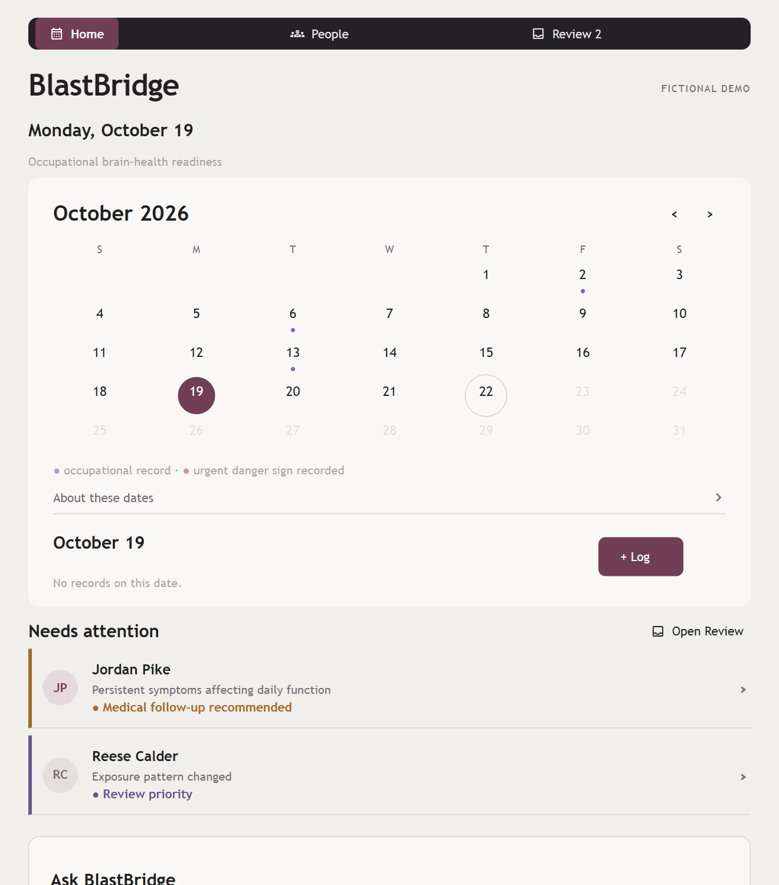
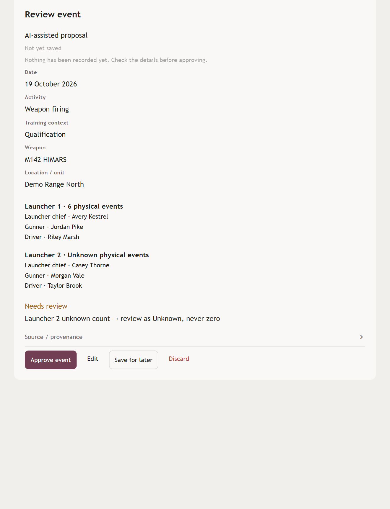
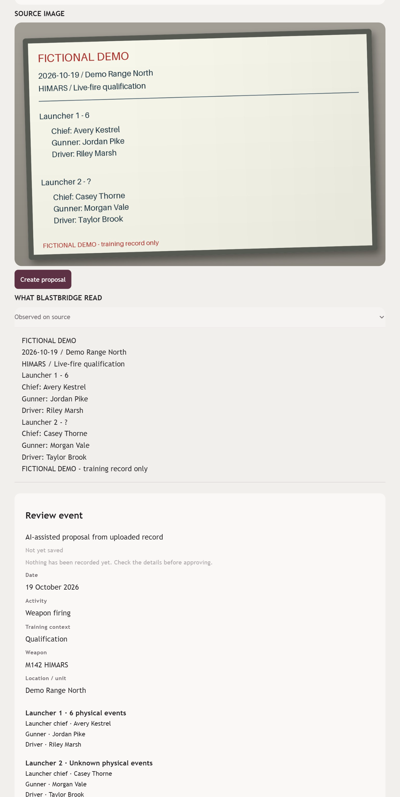
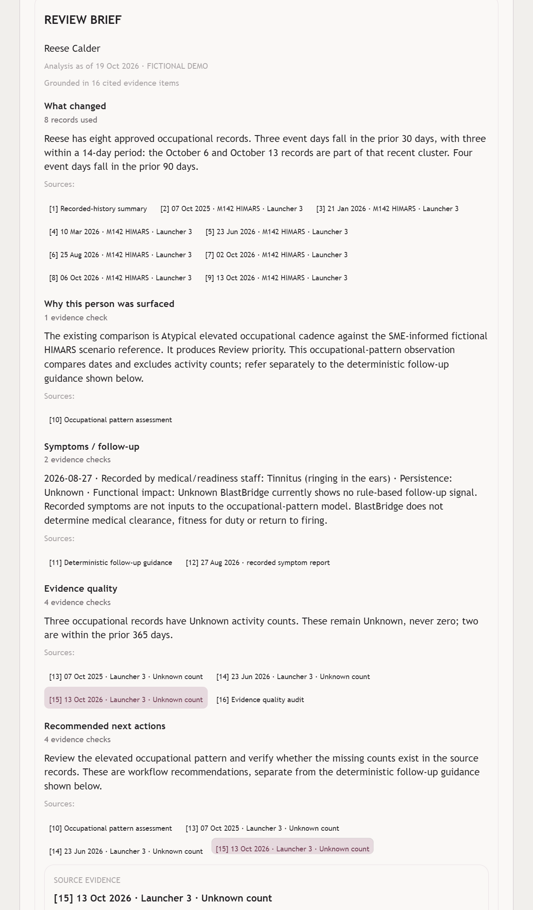
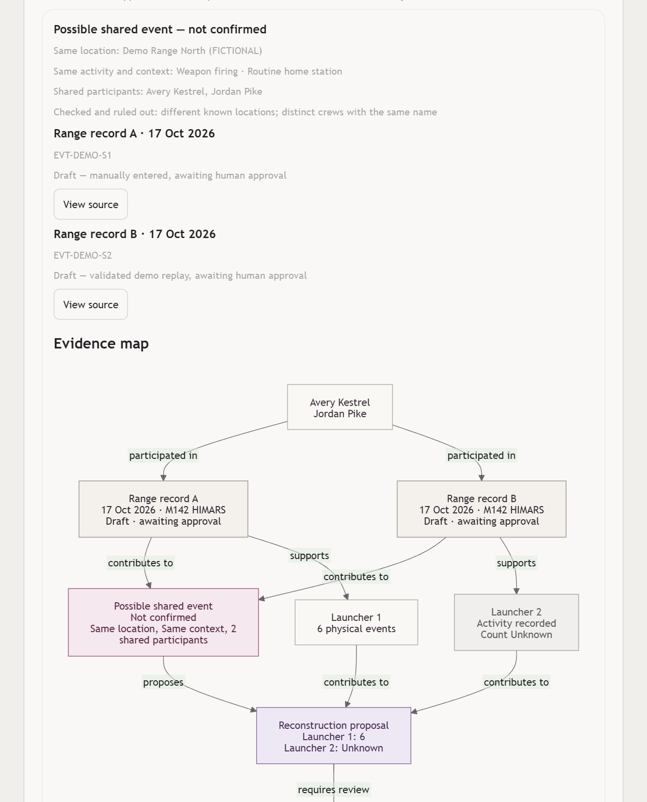
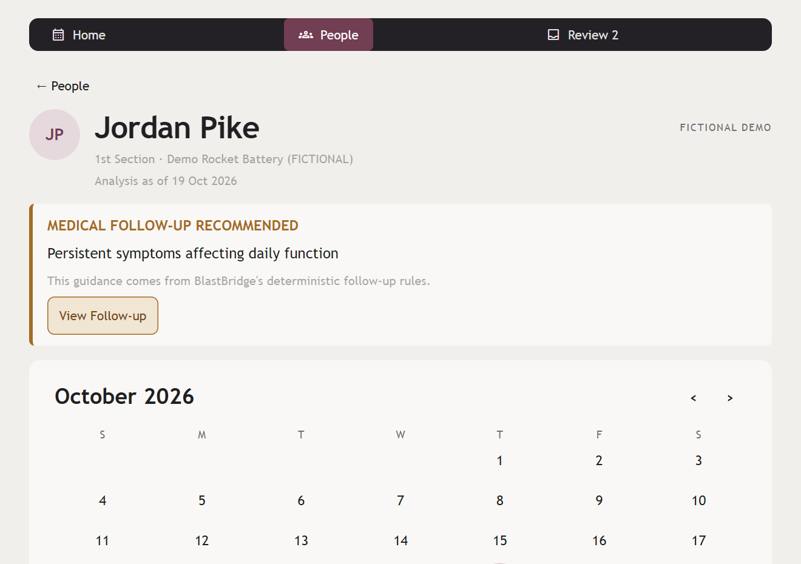

# BlastBridge

AI-assisted occupational blast-exposure records and review for military training, using fictional demo data.

**Exposure is not injury.** BlastBridge records training activity and supports human review;
it does not diagnose TBI, predict injury, assign medical probabilities or determine medical clearance.
A symptom report after an event is a temporal association, not evidence of causation.
Use only fictional records in this demo, never real personnel, medical, PHI/PII, controlled or operational records.

## What it does

- **Training intake:** Claude structures text or a photographed training record using fictional-roster
  and weapon-catalog tools. Unknown stays Unknown. Text, photo and manual entry converge on one
  **Review event** decision: Approve event, Edit, Save for later or Discard.
- **Longitudinal history:** approved records connect dates, people, crews and roles in organization
  and person calendars. Drafts and rejected records stay out of personnel history.
- **Occupational-pattern comparison:** IsolationForest compares recorded HIMARS event-day cadence
  with an SME-informed fictional HIMARS scenario reference. Elevated atypical activity is a review
  signal only; symptoms and physical-event counts are excluded from the model.
- **Symptom follow-up:** human-confirmed structured reports feed deterministic TBICoE/CDC guidance
  rules, separate from the occupational-pattern model. Guidance is not a diagnosis.
- **Ask BlastBridge:** a bounded analyst uses application tools to produce an evidence-cited
  **Review brief**. Click numbered citations to inspect structured source evidence and open its record or view.
- **Evidence Intelligence:** possible duplicate records have field comparisons and an **Evidence map**.
  Reconstructions preserve conflicts and Unknowns and require a human decision before entering history.

## Screenshots

| Home | Review event | Photo intake |
| --- | --- | --- |
|  |  |  |

| Review brief | Evidence map | Person follow-up |
| --- | --- | --- |
|  |  |  |

## Quick start

Use **Python 3.12** from the repository root.

Windows PowerShell:

```powershell
py -3.12 -m venv .venv
.\.venv\Scripts\Activate.ps1
pip install -e ".[app]"
streamlit run app/streamlit_app.py
```

macOS / Linux:

```bash
python3.12 -m venv .venv
source .venv/bin/activate
pip install -e ".[app]"
streamlit run app/streamlit_app.py
```

After dependencies are installed, the demo works offline with deterministic scripted replays.
Without a live key, suggested Ask requests use their bundled replays, and **Use demo replay**
supplies the fictional text-intake example. Photo replay accepts only the bundled
[demo board image](examples/fictional/intake/demo_range_board.png), matched by SHA-256;
other images require live AI or manual entry. Uploaded image bytes remain session-only.

Live AI is optional. Set `ANTHROPIC_API_KEY` in the launching environment, then start Streamlit:

```powershell
$env:ANTHROPIC_API_KEY = "your-key"
```

```bash
export ANTHROPIC_API_KEY="your-key"
```

The app reads environment variables directly; **there is no `.env` loader**.
Demo records live in a local SQLite database (`BLASTBRIDGE_DB` can override its path).

**Presentation mode:** set `BLASTBRIDGE_DEMO_MODE=replay` in the launching environment
(`$env:BLASTBRIDGE_DEMO_MODE = "replay"` in PowerShell, or
`export BLASTBRIDGE_DEMO_MODE=replay` on macOS/Linux). Suggested Ask requests then use deterministic
replays even with an API key; other free-typed questions can still use live AI. Fresh sessions start
on 19 Oct 2026. Eligible live failures fall back to replay with an explicit on-screen caption.
The bundled demo board image also replays in presentation mode or on live failure, with fallback labeled.

## Three-minute demo

Presenting live? Use the [presenter run sheet](docs/DEMO.md) (checklist, timed click path, recovery moves, judge Q&A). A two-minute [backup recording](docs/demo/blastbridge-demo.webm) of the full flow is included.

1. Start at **Home → Needs attention**. If a replay-date notice appears, click
   **Use demo date (19 Oct 2026)**. This changes the analysis/calendar view without resetting the database;
   repeat the suggested request after changing the date.
2. Open **Jordan Pike** from Home or People. Inspect the medical follow-up band and click
   **View Follow-up** to see deterministic guidance and sources.
3. Open **Reese Calder → Summarize Reese for review**. In the Review brief, click a record,
   Unknown-count and occupational-pattern citation to inspect their source cards.
4. Open **Log training event**. Choose **Describe / paste training record → Use demo replay**,
   or **Upload / photograph record**, upload `examples/fictional/intake/demo_range_board.png`,
   and click **Create proposal**. At **Review event**, check the details and Unknown count, then
   choose **Approve event** or **Save for later**. Approval enters history; saving leaves a draft in Review.
5. From **Home → Find possible duplicate records → Compare sources**, inspect the **Evidence map**
   and field comparison. Choose **Create training draft**, then decide in **Review**.
   Sources are unchanged; the app does not silently discard them or confirm that they describe one event.

For a repeatable starting database, **Home → Demo / Advanced → Reset to demo state** requires
confirmation and replaces recorded events and symptom reports with the fictional fixtures.
Unlike **Use demo date**, this reset changes stored data.

## How the AI is kept honest

Tool/model-call budgets are bounded. Roster/catalog lookups and a Python grounding gate constrain
intake; analyst references are validated against returned evidence. Medical section text comes
from application-owned deterministic guidance. Humans approve training events and confirm symptom
reports. Provenance distinguishes manual, live-AI and replay input. No AI confidence percentages
or injury probabilities are presented. Replays are scripted demonstrations, not fresh live responses.

## Architecture

| Location | Responsibility |
| --- | --- |
| `app/` | Streamlit UI, navigation, calendars and human decisions |
| `src/blastbridge/product/agent.py`, `image_intake.py` | Shared bounded intake and photo-of-record envelope |
| `analyst.py`, `analyst_tools.py` | Ask BlastBridge, evidence tools and grounding |
| `briefing.py` | Code-owned citation labels and captured-evidence source cards |
| `evidence.py`, `evidence_graph.py` | Deterministic comparisons/reconstruction and read-only provenance map |
| `readiness.py`, `followup.py`, `symptoms.py` | Deterministic states and confirmed symptom guidance |
| `patterns.py` | Occupational cadence comparison with the fictional scenario reference |
| `review_flow.py`, `store.py` | Save/approve fail-safe, revision protections and SQLite persistence |
| `data/`, `examples/fictional/` | Versioned public references, fictional scenarios and replays |

Module names after the first product row are relative to `src/blastbridge/product/`.
[PRODUCT.md](PRODUCT.md) documents model assumptions, coverage and reference limitations.

## Development

In an activated Python 3.12 environment:

```bash
pip install -e ".[dev,app]"
pytest
ruff check .
ruff format --check .
mypy
python -m blastbridge.validation.reference
python -m blastbridge.validation.priors
```

The reference and priors validators need no gitignored source downloads. Training-tempo source
audits and optional source-archive release checks require local research originals; see
[reference guidance](data/reference/README.md). Historical-release tests require the repository's
annotated release tags. CI fetches history/tags and runs the checks above.
`requirements-dev.lock.txt` records a development-tool snapshot; `pyproject.toml` specifies compatible ranges.

## Research foundation

The original typed research records and validators remain available alongside the product prototype.
Dataset/schema versions are independent of the Python package version, which remains **0.1.0**.

- **V0.1 (0.1.0):** 18 weapon/category records, eight occupational specialties, 12 supported
  relationships, ten taxonomy nodes and 11 official sources. Field-level citations preserve source
  scope and conflicts. HIMARS, MLRS and Abrams Tier-1 status remains unknown under the reviewed
  2021 report; no category is invented. See the [V0.1 review](research/notes/reference-v0.1.md).
- **V0.2:** 40 training-tempo evidence records, 31 sources (29 official, one SME recollection and
  one research-definition source), eight counting definitions and a separate release manifest.
  Requirements, observations, plans and recollections are distinct. All 29 official sources lack
  archived originals and retain retrieval limitations. V0.1 JSON was retained byte-for-byte from
  `v0.1.0` at `0c3ede2dadff3b21dda2c901407a214658f63b9b`.
  See the [V0.2 review](research/notes/training-tempo-v0.2.md).
- **V0.3:** prior/uncertainty design, not empirical population priors. `empirical_priors` remains
  null; source claims do not establish individual annual exposure frequency or medical truth.
  Earlier release artifacts are retained, and tagged-tree checks verify historical releases
  independently of the current README. See [prior design](research/notes/prior-design-v0.3.md)
  and [dependency modeling](research/notes/dependency-modeling-v0.3.md).

Pydantic models preserve provenance and distinguish measured, estimated, self-reported, synthetic
and documented evidence. Unknown quantities use `None`, never zero. Pressure and impulse require
their own units and evidence; there are no undocumented weapon defaults, cumulative-dose formulas
or physiological thresholds. Research estimate-confidence annotations are not injury probabilities
and are separate from the product's AI presentation. Real and synthetic records require separate
validated batches; individual records alone cannot validate cross-record links.

The product's runtime-fitted IsolationForest and arranged fictional histories are demonstration
components, not an empirical population model or clinical validation. Historical V0.4/V0.5 design
notes remain in [research/notes/](research/notes/); they do not authorize real synthetic population
generation. Read [data governance](research/notes/data-governance.md),
[dataset decisions](research/notes/dataset-decisions.md) and the
[repository migration record](research/notes/repository-migration.md) before research use.
No repository license has been selected; licensing and data-use terms need a decision before distribution.
